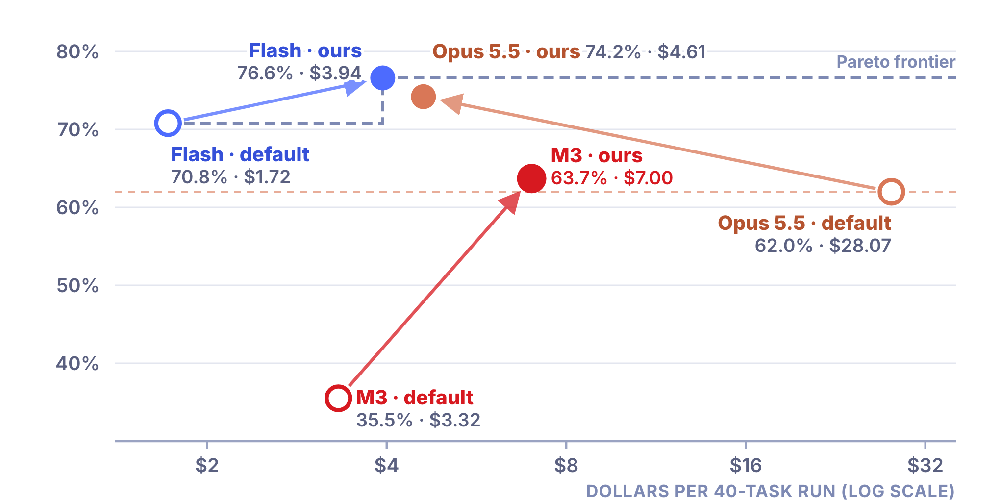

# Engineering, not spending: cost-aware harness optimization on TUA-Bench

Course project for **PE6203 Generative AI & Agentic AI** at Nanyang Technological University (NTU), Group Project 5, Group 2: Zhao Xiaonan, Liu Xinyao, Shi Zhiyun, Chen Yayue, Meng Sijia. October 2026.

We kept the model, the tasks and the verifiers fixed and changed only the **harness**, the software around the model that decides the tools, what the model sees after each step, the budget and when the agent stops. On a fixed 40-task subset of [TUA-Bench](https://github.com/facebookresearch/TUA-Bench), five harness components on one subclass of Terminus-2 lifted the cheap model **MiniMax M3 from 35.5% to 63.7% at $7.00 per run, matching Claude Opus 5.5 with the default harness (62.0% at $28.07) at a quarter of the cost**. Task by task, M3 gained 13 tasks and lost 2 (sign test p = 0.007).

- Full report: [report/REPORT.md](report/REPORT.md)
- Failure analysis and per-component evidence: [docs/failure-analysis.md](docs/failure-analysis.md)
- Slides: [report/slides/Group2_CostAwareHarness.pdf](report/slides/Group2_CostAwareHarness.pdf)
- Raw logs for all 440 runs: attached to the [GitHub release](https://github.com/Lapis0x0/PE6203-cost-aware-harness/releases/tag/v1.0)



## Results

40 tasks, one provider and one price table, 2400 s per task, one run per configuration. Cost is dollars per 40-task run at list price.

| Configuration | Harness | Success | $ / run |
|---|---|---|---|
| MiniMax M3 | default Terminus-2 | 35.5% | $3.32 |
| MiniMax M3 | **ours** | **63.7%** | **$7.00** |
| DeepSeek V4.1 Flash | default Terminus-2 | 70.8% | $1.72 |
| DeepSeek V4.1 Flash | ours | 76.6% | $3.94 |
| Claude Opus 5.5 | default Terminus-2 | 62.0% | $28.07 |
| Claude Opus 5.5 | ours | 74.2% | $4.61 |

Ablation on M3, one component at a time from the default baseline:

| Component | Success | Tasks gained / lost | $ / run |
|---|---|---|---|
| C1 native tool calls | 53.8% | +9 / −2 | $6.72 |
| C2 pre-submit check | 59.7% | +11 / −2 | $4.33 |
| C3 stall + budget | 49.7% | +8 / −2 | $2.30 |
| C4 domain notes | 49.4% | +9 / −4 | $4.85 |
| C5 output denoise | 56.1% | +11 / −4 | $4.06 |
| All five | 63.7% | +13 / −2 | $7.00 |

With one run of 40 tasks a success rate carries about ±7.6 points of standard error, and about one task in five flips between two identical runs, so read single-component rows as direction rather than ranking. See the report for the discussion and limitations.

## The harness

`harness/cah_agent/agent.py` defines `CostAwareTerminus`, a subclass of Harbor 0.6.3's `Terminus2` with five switches. With every switch off it reproduces the default harness (checked by an offline test).

| Switch | Component | What it does |
|---|---|---|
| `c1_native_tools` | C1 native tool calls | `bash`, `write_file` and `task_complete` as real function calls instead of JSON in text; reasoning carries over between turns; `bash` presses Enter by default. |
| `c2_verify_gate` | C2 pre-submit check | The first "done" triggers a checklist and a read-only script in the container that re-opens changed Office files (missing formula values, broken XML, unreadable files). At most two gates per task. |
| `c3_stall_budget` | C3 stall + budget | Time notices at 50 / 75 / 90% of the budget; a "step back" hint when the same command or error repeats; Ctrl+C and then a fresh shell when the terminal freezes. |
| `c4_domain_notes` | C4 domain notes | One short list of general tips appended to the prompt, the same for every task (`harness/cah_agent/notes.py`). |
| `c5_obs_denoise` | C5 output denoise | Drops browser, dbus and font warnings and folds repeated lines in new observations only, so prompt caching still hits. |

No component contains task names, file names, URLs or answers, and the harness makes no extra model calls. The components were designed from the failures of our earlier default-harness baselines (Flash, Opus and Qwen3.6-35B-A3B); M3 replaced Qwen3.6 as the weak model afterwards, because our provider gave Qwen3.6 no cache discount and that distorted the cost comparison. The only M3-specific change is the Enter default in C1, found in a hand-read smoke test.

## Repository layout

```
harness/cah_agent/   the harness: agent.py (subclass and components), notes.py (C4 and C2 text),
                     artifact_check.py (C2 in-container check), templates/tools.txt (C1 prompt)
harness/tests/       offline tests (no containers, no model calls) and a C1 reasoning probe
configs/             one JSON per configuration, the 40-task subset (seed 6203) and task families
scripts/             run_config.py (run one config), start.sh / run_queue.sh / watchdog.sh /
                     pipeline.sh / gate.py (unattended queue), summarize.py, export_results.py,
                     compute_metrics.py
runner-patches/      patches to Harbor 0.6.3 (see below)
pricing/             price table used for cost, and provider price-list snapshots
analysis/            all_runs.json (per-task results) and metrics.json (everything in the report)
report/              REPORT.md, charts (with sources) and slides
docs/                failure analysis and component evidence
```

## Runner patches

Applied to Harbor 0.6.3. None changes a task or a verifier.

- `harbor-0.6.3-remove-chrome-state.patch`: removes a helper script whose `solved` mode opened the answer page in 12 browser tasks. Verified with the official oracle on task 041 (score 1 before, 0 after). Applied to every configuration.
- `harbor-0.6.3-stream-aggregate.patch`: our provider returned MiniMax M3's non-streamed replies twice; this calls the model with streaming and aggregates the result.
- `harbor-0.6.3-docker-chmod-root.patch`: runs Harbor's `chmod` of the log directories as root. The TUA-Bench images default to a non-root user, so without it the chmod fails silently and the verifier cannot write the reward or save its output files.
- `harbor-0.6.3-daytona-root.patch`: the same fix for the Daytona cloud sandbox, which we tried first and abandoned; not used in the reported runs.

## Reproducing a configuration

The scripts assume this layout under `~/cost-aware-harness/` (paths are set at the top of `scripts/run_config.py`):

1. Clone this repository to `~/cost-aware-harness` and TUA-Bench into `~/cost-aware-harness/TUA-Bench` (we used commit `3497fd3`).
2. Create a virtualenv at `~/cost-aware-harness/.venv-harbor`, install `harbor==0.6.3`, and apply the patches in `runner-patches/` to the installed package.
3. Put the provider endpoint and key in `~/cost-aware-harness/.env` as `ATLASCLOUD_BASE_URL` and `ATLASCLOUD_API_KEY`. All models were called through one provider, Atlas Cloud, with an OpenAI-compatible endpoint; to use another provider, change `model`, `api_base_env` and `price_id` in the config and add prices to `pricing/prices.json`.
4. Run one configuration (tasks run one at a time in local Docker; finished tasks are skipped, so rerunning resumes):

   ```
   python3 scripts/run_config.py configs/H-m3.json
   ```

   For each task this calls `harbor run ... --agent-import-path cah_agent:CostAwareTerminus -m <model> --ak c1_native_tools=true ... -e docker -n 1`, with `harness/` on `PYTHONPATH`. Results go to `jobs/<config>/<task>/`.
5. Summarize and recompute the report's numbers:

   ```
   python3 scripts/summarize.py H-m3
   python3 scripts/export_results.py > analysis/all_runs.json
   python3 scripts/compute_metrics.py
   bash report/charts/build.sh
   ```

One configuration took roughly 2 to 12 hours on a small VPS. The offline tests run without containers or model calls in any environment with Harbor installed: `python3 harness/tests/test_offline.py`.

## Raw logs

The [release](https://github.com/Lapis0x0/PE6203-cost-aware-harness/releases/tag/v1.0) has one archive per configuration (`logs-<config>.tar.gz`, about 13 MB in total). Each unpacks to `<config>/<task>/` with `config.json`, `result.json`, `trial.log`, `agent/trajectory.json` and `verifier/`, for the last trial of each task, the same rule `scripts/export_results.py` uses; recomputing success from these files reproduces every number above. `logs-B0-qwen36.tar.gz` holds the earlier weak-model baseline (27.4%) that the failure analysis refers to.
