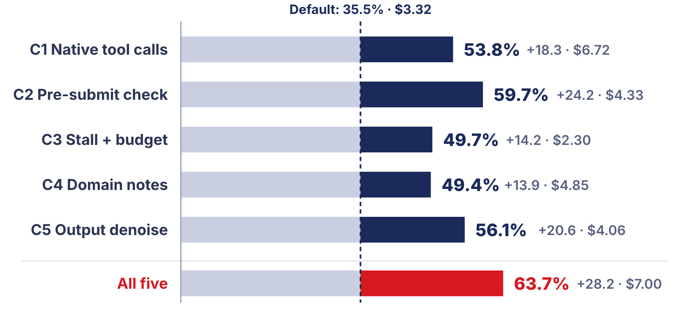
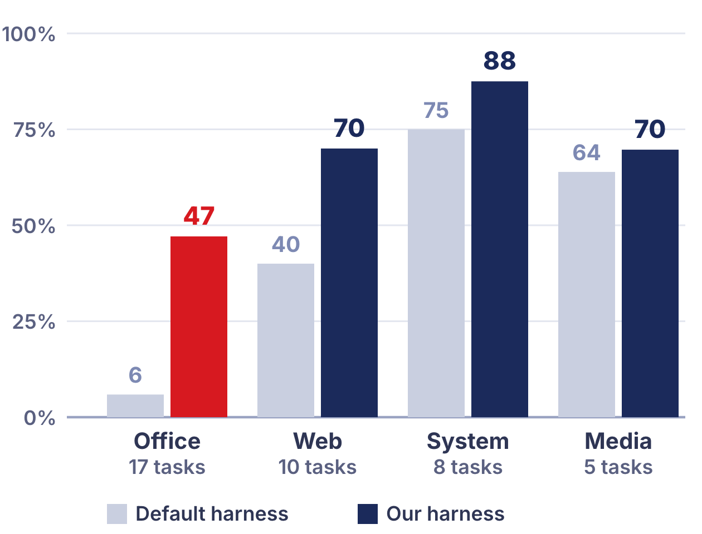
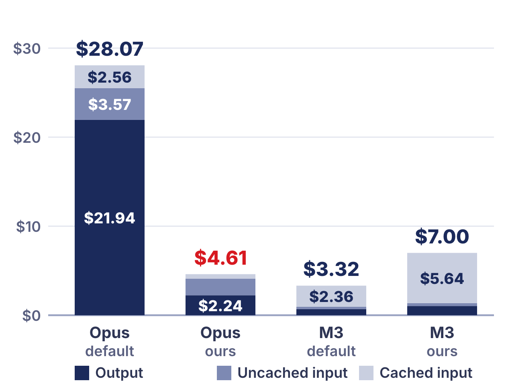

# Engineering, Not Spending: Cost-Aware Harness Optimization on TUA-Bench

PE6203 Generative AI & Agentic AI · Group Project 5 · Group 2: Zhao Xiaonan, Liu Xinyao, Shi Zhiyun, Chen Yayue, Meng Sijia · October 2026

## Summary

We changed only the harness around a cheap model and measured success rate and dollars per run on a fixed 40-task subset of TUA-Bench. With our five harness components, MiniMax M3 rose from 35.5% to 63.7% at $7.00 per run, matching Claude Opus 5.5 with the default Terminus-2 harness (62.0% at $28.07) at a quarter of the cost. The M3 improvement is clear at the task level: 13 tasks gained and 2 lost (two-sided sign test p = 0.007). Every single component points up (+14 to +24 points); the pre-submission check is the strongest on its own (11 gained, 2 lost, p = 0.022) and has the clearest causal case in the trajectories. Our harness also took DeepSeek V4.1 Flash to 76.6%, the highest score of all eleven configurations, and Flash with the default harness and Flash with ours form the Pareto frontier. Applied to Opus 5.5, the same harness cut its cost from $28.07 to $4.61 (6.1 times cheaper) and raised its success rate to 74.2% (+12.2 points, 6 tasks gained, 1 lost), because the default protocol made Opus spend most of its budget on output and on a few runaway tasks. Harness overhead is small: our harness makes no extra model calls, and the text it injects is about 1% of input tokens for the cheap models. Along the way we found and removed an answer leak in 12 browser tasks, which made the benchmark harder (Opus 67.0% to 62.0%).

## 1. Question

An agent harness is the software layer around a language model: it renders the prompt, exposes the tools, decides what the model sees after each step, tracks the budget and decides when the agent stops. TUA-Bench (120 real terminal tasks, each executed in a container and graded by an execution-based verifier) shows that the harness can matter as much as the model. The project asks whether harness engineering can substitute for model spending: can a cheap base model running our harness reach a higher success rate than an expensive model running the default harness, at a lower cost per run?

## 2. Setup

**Benchmark and subset.** TUA-Bench with the official tasks and verifiers, run through Harbor 0.6.3. Because we run tasks one at a time on a small VPS, we restricted the pool to tasks that need one CPU core and drew a 40-task subset stratified by task family with seed 6203, before any experiment: Office & Productivity 17, Web & Information 10, System & Software Operations 8, Multimedia & Design 5. Every configuration uses this subset.

**Models.** MiniMax M3 is the cheap base model we optimize. DeepSeek V4.1 Flash is a second cheap model. Claude Opus 5.5 is the expensive model. Decoding settings are fixed per model and identical across harness variants (Opus: adaptive thinking, max_tokens 16000, default temperature).

**Cost accounting.** All models are called through one provider, Atlas Cloud. Cost per run is the sum over the 40 tasks of uncached input, cached input and output tokens, each multiplied by the provider's list price (snapshot of its `/v1/models` table, 1 October 2026). Prices per million tokens (input / cached input / output): M3 $0.30 / $0.06 / $1.20; Flash $0.30 / $0.03 / $1.20; Opus 5.5 $4.00 / $0.20 / $20.00. We do not model a cache-write premium; this applies equally to both Opus configurations.

**Budget.** 2400 seconds per task (the benchmark default) and no step limit, identical for every variant. One run per configuration. We compare configurations task by task with a two-sided sign test on the tasks that changed outcome.

**Runner fixes.** We made three changes to the runner, none to tasks or verifiers. (1) While reading failure trajectories we found that 12 browser tasks shipped a helper script with a "solved" mode that navigated directly to the answer page, and Flash and Opus used it. We removed it and re-ran the affected tasks: Flash stayed at 70.8%, Opus fell from 67.0% to 62.0%. All numbers in this report are after the fix. (2) The provider repeated M3's replies in non-streamed responses, so all calls are streamed and aggregated. (3) The runner saves the agent's output files for inspection.

## 3. Our harness

We forked Terminus-2 as a subclass, `CostAwareTerminus`, loaded through Harbor's `--agent-import-path`. Each component is an on/off switch; with all switches off the subclass reproduces the default harness (checked by an offline test). The harness makes no model calls of its own. Each component targets one part of the optimization surface in the brief and knows nothing about specific tasks.

| Component | Surface | What it does |
|---|---|---|
| C1 Native tool calls | Tool interface | Replaces JSON-in-text with real function calls: `bash`, `write_file`, `task_complete`. The model's reasoning is carried across turns inside the tool-calling loop. `bash` presses Enter by default; a single tmux key such as `C-c` is sent as that key; a literal `\n` at the end is repaired. |
| C2 Pre-submit check | Verification | The first time the agent declares completion, the harness shows a verification checklist and runs a script in the container that re-opens every Office file created or changed during the task and reports problems (unreadable files, formula cells without stored values, broken XML). The agent must confirm again; at most two gates per task. |
| C3 Stall + budget | Failure detection, budget | Time notices at 50%, 75% and 90% of the budget. If the same command or the same error lines appear three times, a notice tells the agent to step back and try another approach. If the terminal does not change for three steps although keys were sent, the harness sends Ctrl+C; after five, it restarts the shell. |
| C4 Domain notes | Prompt | One short list of general tips added to the system prompt, the same for every task: look around before acting, reuse a running browser, prefer high-level Office libraries, recalculate formulas after openpyxl, build the real feature rather than a static imitation, quit desktop applications properly so settings are saved. |
| C5 Output denoise | Context management | Removes browser, dbus, font and audio warning lines from terminal output and folds runs of identical lines, before the default truncation. |

The components came from reading the 32 failed tasks of the three default baselines ([docs/failure-analysis.md §1](../docs/failure-analysis.md#1-baseline-failures-where-the-components-came-from)). Before the full runs, a four-task smoke test with every trajectory read by hand caught one weak-model habit: M3 left 40–60% of its commands without a trailing newline, so they were typed but never executed. That is why `bash` presses Enter by default. The full experiment (11 configurations × 40 tasks) then ran unattended on a VPS with automatic gates and a watchdog.

## 4. Results

### 4.1 Accuracy–cost plane

The figure shows the three models with the default harness (hollow) and with our full harness (solid). The five single-component runs are listed in the table below and discussed in Section 4.2.

| Configuration | Harness | Success | Full solves | $ / run | Input tok (cached) | Output tok | Steps | Agent time (min) |
|---|---|---:|---:|---:|---:|---:|---:|---:|
| MiniMax M3 | default | 35.5% | 13/40 | 3.32 | 40.2M (39.3M) | 0.57M | 1,321 | 286 |
| MiniMax M3 | C1 only | 53.8% | 21/40 | 6.72 | 86.3M (85.1M) | 1.03M | 2,618 | 420 |
| MiniMax M3 | C2 only | 59.7% | 23/40 | 4.33 | 55.6M (54.6M) | 0.63M | 1,657 | 329 |
| MiniMax M3 | C3 only | 49.7% | 19/40 | 2.30 | 25.6M (24.8M) | 0.48M | 1,149 | 225 |
| MiniMax M3 | C4 only | 49.4% | 19/40 | 4.85 | 64.7M (63.8M) | 0.63M | 1,605 | 292 |
| MiniMax M3 | C5 only | 56.1% | 22/40 | 4.06 | 51.1M (50.0M) | 0.61M | 1,461 | 323 |
| MiniMax M3 | ours (all five) | 63.7% | 25/40 | 7.00 | 95.1M (94.0M) | 0.86M | 2,838 | 477 |
| DeepSeek V4.1 Flash | default | 70.8% | 28/40 | 1.72 | 10.6M (9.8M) | 0.98M | 615 | 142 |
| DeepSeek V4.1 Flash | ours | 76.6% | 30/40 | 3.94 | 68.1M (65.9M) | 1.08M | 1,754 | 296 |
| Claude Opus 5.5 | default | 62.0% | 24/40 | 28.07 | 13.7M (12.8M) | 1.10M | 618 | 312 |
| Claude Opus 5.5 | ours | 74.2% | 29/40 | 4.61 | 3.0M (2.5M) | 0.11M | 432 | 106 |

Success is the mean per-task reward; two video tasks give partial credit, so "full solves" counts tasks with reward 1. The answer to the central question is yes: M3 with our harness (63.7%, $7.00) matches Opus 5.5 with the default harness (62.0%, $28.07) at a quarter of the cost. Flash with our harness (76.6%, $3.94) is the highest score of all eleven configurations. The Pareto frontier over all eleven configurations is formed by Flash: Flash with the default harness is the cheapest point (70.8%, $1.72), Flash with our harness the most accurate. Opus with the default harness is dominated by every configuration with our harness.

### 4.2 Component ablation

| Variant (on M3) | Success | Δ vs default | Tasks gained / lost | Sign test p | $ / run |
|---|---:|---:|---:|---:|---:|
| Default Terminus-2 (B0) | 35.5% | – | – | – | 3.32 |
| C1 native tool calls | 53.8% | +18.3 | 9 / 2 | 0.065 | 6.72 |
| C2 pre-submit check | 59.7% | +24.2 | 11 / 2 | 0.022 | 4.33 |
| C3 stall + budget | 49.7% | +14.2 | 8 / 2 | 0.109 | 2.30 |
| C4 domain notes | 49.4% | +13.9 | 9 / 4 | 0.267 | 4.85 |
| C5 output denoise | 56.1% | +20.6 | 11 / 4 | 0.118 | 4.06 |
| All five (H) | 63.7% | +28.2 | 13 / 2 | 0.007 | 7.00 |

Each row switches on one component from the same baseline. Every component points up, C2 is the strongest single component (11 gained, 2 lost, p = 0.022), and combined the five reach the Opus line (13 gained, 2 lost, p = 0.007). The components cover the same failures from different sides: 15 tasks are rescued by at least one single component and 13 of them by three or more. C3 alone ran M3 for $2.30, cheaper than the default $3.32.

We read the trajectories behind the flips ([docs/failure-analysis.md §2](../docs/failure-analysis.md#2-component-evidence-in-the-ablation-trajectories)). The failures the components turn into passes are mostly route forks: which URL form the agent submits, whether it builds a virtualenv, whether it starts its own X server, and stopping too early. M3 under the default harness stops early (17 of its 27 failures end within 30 steps), not because of format errors: only 0.45% of its steps were lost to unparsable replies.

Two flips have a clear causal trace. C2 on task 018: the model wrote the right formula but saved the workbook without computed values; the check reported `2 formula cells have no cached value`, the model recalculated with LibreOffice, copied the file back and passed (every M3 run that copied the recalculated file back passed; every run that only recalculated a copy failed). C3 on task 048 (full harness): after a stall notice the model explicitly quoted it, abandoned an archive.org workaround and found that a different user agent unblocked the site.

### 4.3 Where the gain lands

| Family (tasks) | M3 default | M3 ours | Flash default | Flash ours | Opus default | Opus ours |
|---|---:|---:|---:|---:|---:|---:|
| Office & Productivity (17) | 5.9% | 47.1% | 58.8% | 70.6% | 47.1% | 58.8% |
| Web & Information (10) | 40.0% | 70.0% | 80.0% | 80.0% | 70.0% | 90.0% |
| System & Software Operations (8) | 75.0% | 87.5% | 87.5% | 100.0% | 100.0% | 87.5% |
| Multimedia & Design (5) | 63.9% | 69.7% | 66.8% | 53.0% | 36.1% | 73.4% |

Most of M3's gain is in Office tasks (5.9% → 47.1% on 17 tasks). These tasks fail silently: the model writes a formula with openpyxl but the saved workbook has no computed value, and the model believes it is done. C2's file check ran on the changed Office files in 17 of the 40 tasks, but it reported a problem only twice in the C2-only run and never in the full harness, where the model had already recalculated (the C4 note covers the same issue). The checklist text itself, which asks the agent to inspect the final state independently, also produced fixes (task 118: the agent's own XML check found leftover fonts). On Web tasks, C1 alone reached 80%.

## 5. Cost breakdown

| Configuration | Uncached input $ | Cached input $ | Output $ | Agent inference $ | Harness overhead $ (share of input tokens) |
|---|---:|---:|---:|---:|---:|
| MiniMax M3 · default | 0.28 | 2.36 | 0.68 | 3.32 | – |
| MiniMax M3 · ours | 0.33 | 5.64 | 1.03 | 6.92 | 0.077 (1.2%) |
| DeepSeek V4.1 Flash · default | 0.25 | 0.29 | 1.17 | 1.72 | – |
| DeepSeek V4.1 Flash · ours | 0.67 | 1.98 | 1.29 | 3.91 | 0.029 (1.0%) |
| Claude Opus 5.5 · default | 3.57 | 2.56 | 21.94 | 28.07 | – |
| Claude Opus 5.5 · ours | 1.87 | 0.50 | 2.24 | 4.46 | 0.147 (6.3%) |

Our harness makes no model calls of its own (no summarizer, no verifier model, no router), so harness overhead consists only of the text it injects into the conversation: the C4 notes, the C2 checklist and file report, and C3 notices. We estimate it from the trajectories at four characters per token, charging each injected text at the input price the first time and the cached price every time it is re-sent. It is about 1% of input tokens for M3 and Flash; for Opus it is 6.3% because its runs are short, so the fixed notes weigh more. The C2 file check runs in the container and costs time, not tokens.

M3 works longer with our harness ($3.32 → $7.00): steps rose from 1,321 to 2,838 while cost per step stayed at about $0.0025 and the prompt at a given step was in fact shorter. Steps doubled because native tool calls carry one command per turn (the default packed two or more commands into 31% of its turns), because the agent stopped early far less often (tasks finished within 12 steps: 14 → 2), and because of the verification gate (217 extra steps). For Opus the effect is the opposite, as discussed next.

## 6. Failure classification

We read the trajectory and grader output of every task that M3 still fails with our harness (15 tasks; details in [docs/failure-analysis.md §3](../docs/failure-analysis.md#3-what-m3-still-fails-with-our-harness)) and of the default-harness failures ([§1](../docs/failure-analysis.md#1-baseline-failures-where-the-components-came-from)).

| Type | Sub-type | Tasks (M3 + our harness) |
|---|---|---|
| Harness-level, main cause | premature termination, lost context, unparsable calls, no retry | none |
| Model-level | misread the task or took a shortcut | 012, 042, 067 |
| Model-level | misuse of a domain tool or wrong domain knowledge | 013, 016, 058, 061 |
| Model-level | wrong plan | 037, 111 |
| Grader in doubt | every model fails with plausible work, or the grader's view differs from the agent's | 020, 026, 027, 065, 068, 112 |

**Harness-level example (default harness, M3, task 018).** The task asks for a total-earnings formula saved in place. M3 wrote the correct formula with openpyxl, converted a copy in `/tmp` with LibreOffice, read the correct value from the copy and declared completion. The file in `/app` was still the openpyxl save, with no computed values, so the grader read an empty cell. The default harness accepted the completion without inspecting the final artifact: a premature termination that the harness could have caught. In the C2 run, the pre-submission check reported `2 formula cells have no cached value (Sheet1!D3, Sheet1!E3)`, the model answered `I need to use LibreOffice to recalculate and save the file`, copied the recalculated file back and passed. Across all M3 runs, every run that copied the recalculated file back passed and every run that only recalculated a copy failed.

**Model-level example (our harness, M3, task 058).** The task asks to set LibreOffice's autosave interval to 3 minutes. At step 16 M3 reasoned that `AutoSaveTimeIntervall` is in seconds and wrote 180; at step 18 it printed `AutoSave enabled with interval 180s (3 minutes)` and its own verification confirmed the value it had written. The setting is in minutes, so the grader expected 3. The plan was sound and the execution clean; the error is domain knowledge that no generic harness check can supply.

**Next improvement (task 016).** A LibreOffice macro hung in the foreground; the agent kept typing commands, the echoed input changed the screen at every step, and our stall detector, which compares a hash of the whole terminal buffer, missed the hang for about eight steps until the model pressed Ctrl+C itself. Later the agent hand-wrote the pivot table's XML; the pre-submission check reported that the file opens, and the agent cited that as proof the pivot table was correct. It was not (the pivot fields lack their item lists). Two lessons for the next version: a check should say what it does not verify, and stall detection should ignore echoed input.

**Grader in doubt.** Six tasks fail under every model and harness with plausible solutions. For example, in 027 the grader opens the Steam cart in a new tab and finds no item, although Flash and Opus both saw the item in their own cart view; in 112 the grader compares the saved frame with one specific reference frame although the task asks for "a scene". We did not change any grader.

**Two tasks lost.** Against 13 gained, M3 lost 037 and 111 with our harness. In 037 Cloudflare never let M3 through, so every M3 run guessed the site's URL parameter names from memory; the default run guessed right and the six other M3 runs each guessed differently wrong, while Flash clicked the challenge and read the real parameters. In 111 our run never read the `vlc` wrapper script the task points to (the domain notes even say to read wrapper scripts first) and spent 150 steps building a GNOME background by hand. Both are path choices of a single sample, not traceable to one component.

## 7. Discussion

**Which components account for most of the gain?** The pre-submission check (C2) is the strongest single component (11 gained, 2 lost, p = 0.022) and has the clearest causal trace: it targets silent failures in saved artifacts. Native tool calls (C1) change behaviour the most (one command per turn, reasoning kept across turns, far fewer early stops) and are what makes Opus 6.1 times cheaper, as discussed next. C3 has a clear trace on task 048, where a stall notice made the model change approach. Every component points the same way, and the full set is clearly better than the default (13 gained, 2 lost, p = 0.007).

**Does the gain shrink as the base model gets stronger?** The accuracy gain is largest for the weakest model (M3 +28.2) and positive for both strong models (Flash +5.8 with 5 tasks gained and 3 lost; Opus +12.2 with 6 gained and 1 lost). In cost the gain goes the other way: the same harness made Opus 6.1 times cheaper. With the default Terminus-2 protocol, Opus wrote a JSON analysis and plan every turn and spent 786k thinking tokens over 620 calls; with native tool calls, 214 of its 432 calls used no thinking tokens at all, and its output fell from 1.10M to 0.11M tokens. Both runs used identical settings (adaptive thinking); we checked in the raw API responses that thinking tokens are reported and billed. Its input also fell from 13.7M to 3.0M tokens: under the default, five tasks ran away and used 10.1M input tokens between them. Two (016 and 049) hit the 2400-second limit while each step averaged 4,000 to 4,600 output tokens of thinking, and on 042 Opus reached a CAPTCHA page and spent 99 steps without calling any tool. With our harness the same tasks finished in 7 to 25 steps at about 260 output tokens per step. The stall detector (C3) never fired on them; the change came from the tool-calling protocol. So the harness helps a stronger model too: Opus gets both higher accuracy (74.2%) and a 6.1 times lower bill ($4.61). The default harness was a bottleneck for the strong model as well.

**Lessons.** (1) Read trajectories, not only scores: that is how we found the leaked answer page and the missing Enter key, and how we confirmed that Opus's low cost was real. (2) Design the tool interface for the model you have: weak models have habits, such as omitting the trailing newline, that a tool can absorb. (3) Verification of the final artifact is the cheapest large win for a cheap model.

## 8. Limitations

Each configuration was run once on 40 tasks (standard error about 7.6 points), and about one task in five flips between two identical runs, so we compare configurations task by task and report single-component effects as direction rather than ranking. The next round runs three repetitions per configuration to measure this variance directly. The components were designed by reading failures on the same 40 tasks and kept general, with no task names or answers; the remaining 80 tasks are the held-out test we plan next. The subset covers 1-core tasks only, and extending to multi-core tasks needs a larger machine. Six tasks fail under every model and harness with plausible solutions, which points to grader strictness; we did not change the verifiers, and checking those six against the reference files is a further step.

## 9. Reproduction

Everything behind every number is in the repository: harness code (`harness/cah_agent/`), configurations (`configs/`), the runner scripts (`scripts/run_config.py`, `scripts/summarize.py`, `scripts/export_results.py`, `scripts/compute_metrics.py`), runner patches (`runner-patches/`), the price snapshot (`pricing/`), per-task results (`analysis/all_runs.json`), the chart sources (`report/charts/`) and the failure analysis (`docs/failure-analysis.md`). The raw logs behind every number (result, trajectory and verifier output for each of the 440 runs) are attached to the GitHub release. One configuration runs with `python3 scripts/run_config.py configs/H-m3.json`, which calls `harbor run -p <tasks> -i '*<task>' --agent-import-path cah_agent:CostAwareTerminus -m <model> --ak c1_native_tools=true ... -e docker -n 1` once per task.
